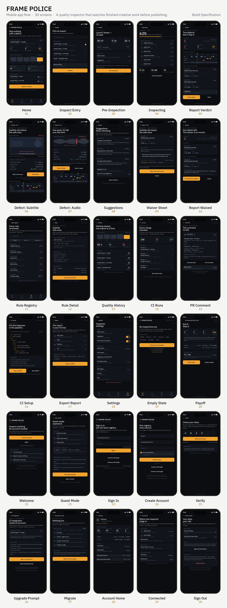
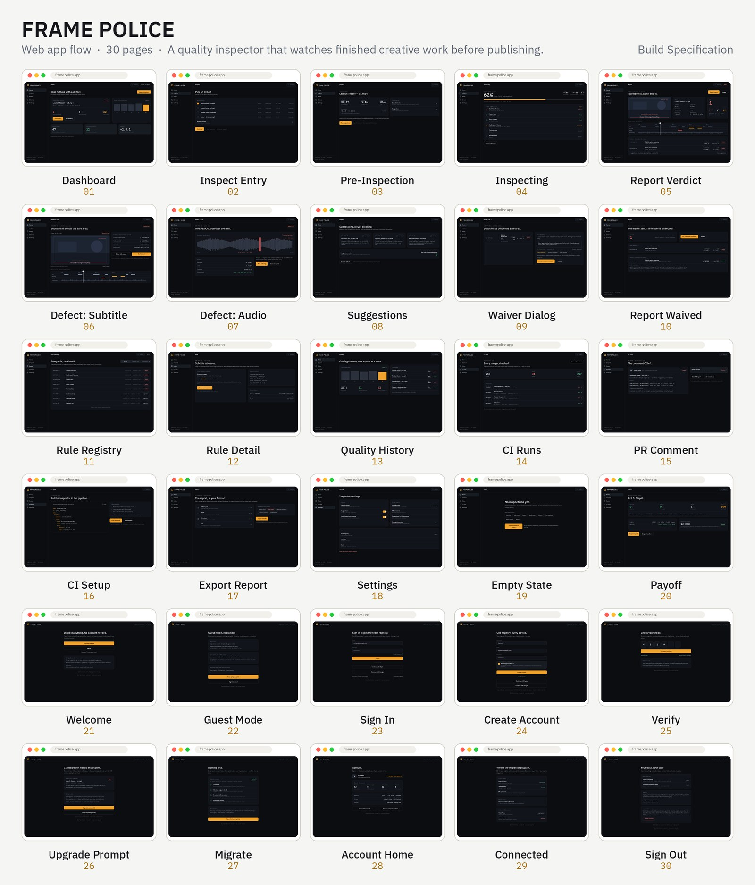

  

# FRAME POLICE

**A linter for video.** It inspects a finished export before it ships — subtitles, audio, frames, text, brand — and answers one question with an exit code: *is this safe to publish?*

👉 **[Try the live demo](https://mr-vishwet.github.io/frame-police/)**

---

## The idea

Machine-checkable defects ship anyway, because nobody runs the checks.

A subtitle sits below the safe area and gets cropped on some players. An audio peak clips. A few black frames slip into the middle of a cut. Text overflows the frame. The brand mark is missing from the export that went to a client. Every one of these is checkable by a machine — and every one of them is still usually caught by a human, after publishing, when it's embarrassing.

Code solved this years ago: linters check every change, and CI refuses to merge what fails. Video exports never got the same treatment. FRAME POLICE is that treatment. Pick an export, and fourteen versioned rules inspect it in seconds. The report separates real defects from mere suggestions, shows the evidence for every finding, and ends in a verdict a pipeline can read: exit 0 means ship it, exit 1 means defects found. The exit code is the verdict — not a vibe, not a review meeting, a number.

The insight that shapes the whole product: **defects and suggestions are separate universes.** A suggestion — loudness could be closer to target, the opening frame is dark — is an opinion, and an opinion must never block a release. The moment an opinion blocks CI, the product has lied. So suggestions never touch the exit code, the score, or anything a pipeline reads. Defects decide. Suggestions advise. That line is the product.

## What it does

### Inspect

Pick an export and fourteen checks run against it: 11 defect checks that decide the verdict, and 3 suggestions that never do. The checks run on the device — nothing uploads. Before the run, the app shows the file's facts and the rule registry version pinned to the inspection, so a report always says exactly which rules ran it.

### The verdict

The report is the heart of the app: an exit code, a score out of 100, marker tracks showing where each finding sits on the timeline, and every finding with its evidence — the timecode, the measured value, and the limit it broke. The score is a guide; the exit code is the verdict.

| Exit code | Meaning |
|---|---|
| `0` | Clean — no open defects. Ship it. |
| `1` | Defects found — one or more open defects. Don't ship it yet. |
| `2` | Inspection error — the file couldn't be read, or the inspection itself failed. An error is not a defect, and the report says so. |

### The demo reel

The demo ships with a reel built to fail: **known-bad.mp4** — 32 seconds, 1080×1920. It inspects in about 19 seconds and comes back with **5 defects and a score of 55**:

- **SUB-SAFE-01 — Subtitle below the safe area.** A subtitle sits below the 90% safe margin, where players can crop it.
- **AUD-PEAK-02 — Audio peak over the limit.** A peak hits above the −1.0 dBFS ceiling.
- **BLACK-FR-01 — Black frames.** Frames in the cut that are entirely black.
- **TXT-OVER-01 — Text overflow.** On-screen text running past the edge of the frame.
- **BRAND-LOGO-01 — Missing brand mark.** The export carries no brand mark at all.

Each finding opens into a detail screen with before/after evidence — the frame as it is, the frame as it should be — so you see the defect, not just its name.

### The rules

The rule registry is versioned — currently **v2.4.1**, 14 rules. A report records the registry version that ran it, so the same export under the same rules always produces the same report. Editing a rule's limit creates a new version of that rule; history is never rewritten.

| Code | Rule | Kind | Limit |
|---|---|---|---|
| SUB-SAFE-01 | Subtitle safe area | Defect | 90% margin |
| AUD-PEAK-02 | Audio peak / silence | Defect | −1.0 dBFS · 1.5 s |
| ASP-RATIO-01 | Aspect ratio | Defect | Project aspect |
| BLACK-FR-01 | Black frames | Defect | 0 black frames |
| TXT-OVER-01 | Text overflow | Defect | No overflow |
| BRAND-LOGO-01 | Brand mark present | Defect | Mark present |
| BRAND-COL-01 | Brand colour usage | Defect | Palette only |
| CAP-SYNC-01 | Caption sync | Defect | ±120 ms |
| TITLE-SAFE-01 | Title safe area | Defect | 85% margin |
| FRAMERATE-01 | Frame rate | Defect | 24 fps |
| RES-MIN-01 | Minimum resolution | Defect | ≥ 1080 px short edge |
| SUG-LOUD-01 | Loudness target | Suggestion | −14.0 LUFS |
| SUG-OPEN-01 | Opening frame brightness | Suggestion | < 50% dark |
| SUG-CAP-01 | Captions file attached | Suggestion | .srt attached |

Every rule can be browsed in the registry, opened for its detail and version history, and enabled or disabled. The registry screen makes the whole system legible: every rule, versioned, in one place.

### Fix

FRAME POLICE is a linter that fixes, not just one that complains. Every defect has a one-tap auto-fix, previewed before and after inline: SUB-SAFE-01 nudges the subtitle back up into the safe area; AUD-PEAK-02 applies a limiter to tame the peak. But a fix is not real until re-inspection confirms it — the exit code stays 1 until the fixed export passes the checks again. A fix that doesn't hold re-opens the defect.

### Waive

Sometimes a defect is deliberate — a client approved the lower-third placement, a platform's safe area differs. Any defect can be waived with a reason (at least 20 characters), and the reason stays in the report. Waiving never deletes the finding: the report shows what was waived, why, and by whom. Waived defects don't block the verdict — the exit code reads 0 once everything open is either fixed-and-confirmed or waived-with-a-reason.

### Ship

Re-inspect, and a clean export lands on exit 0, score 100, the waiver still on record. The report can be exported in four formats — a readable page, structured data, plain text for pasting, and a terminal view — each carrying the same verdict, the same registry version, and the same waiver reasons.

### In the pipeline

The same verdict travels into CI. The inspector runs on every pull request that touches an export; the check reads only the exit code, and a failing check blocks the merge until the export passes. The pull request gets a comment with the verdict — defects listed, evidence linked, merge blocked or cleared. Quality history tracks scores across inspections, so a team can see whether exports are getting cleaner over time.

### Guest-first

No account is needed to inspect. The full inspector — checks, reports, fixes, waivers, history — works as a guest, with everything staying on the device. Signing in adds the team side: one shared registry across devices, shared waivers, and the CI connection. Guest data moves into the account when you sign in, verified item by item, nothing lost.

### About the demo

The inspection in this demo is a labelled demo inspection: the demo reel carries measured values, and files you pick yourself get a deterministic demo probe — the report says so wherever it shows. What the demo shows in full is the product itself: the rules, the verdict, the fixes, the waivers, and the exit-code contract. The numbers inside the demo (sample exports, past inspections, CI runs) are seeded demo content, not measured usage.

## The interface

The app is one experience across phone and web — 30 screens each, same flows, same verdict.

  
   
  <em>Mobile — all 30 screens, from picking an export to the exit-0 payoff.</em>

  
   
  <em>Web — all 30 pages, the same inspector with room to spread out.</em>

