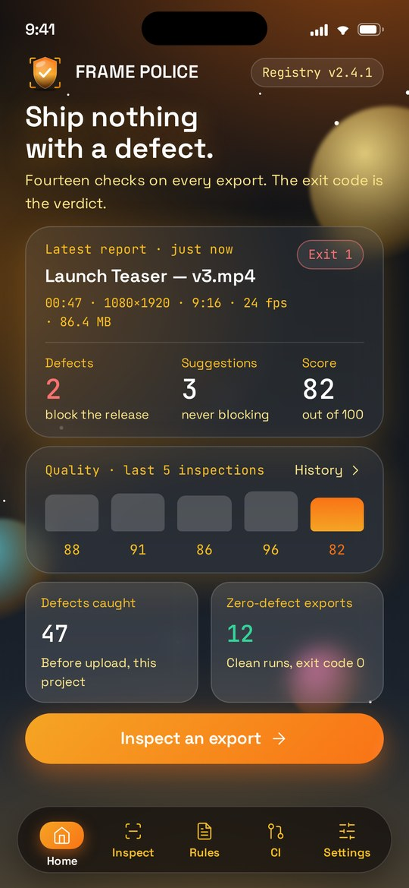
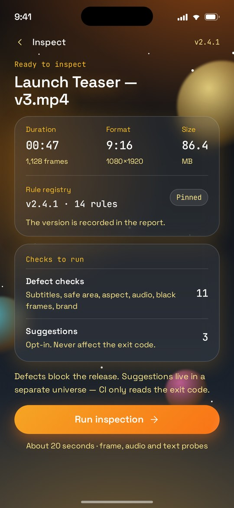
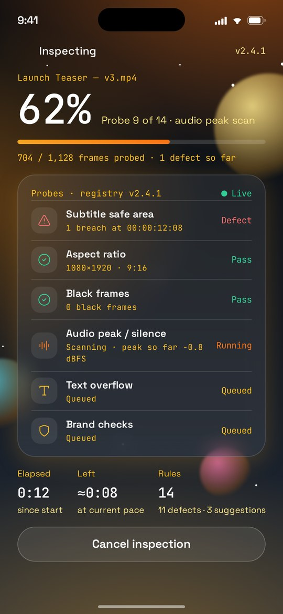
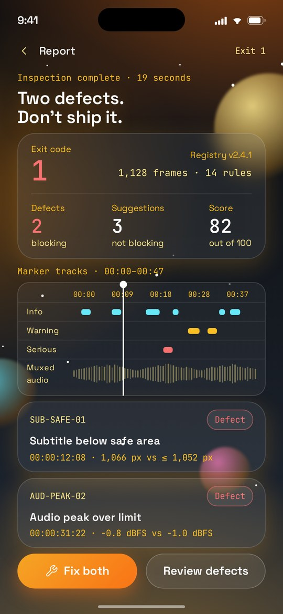
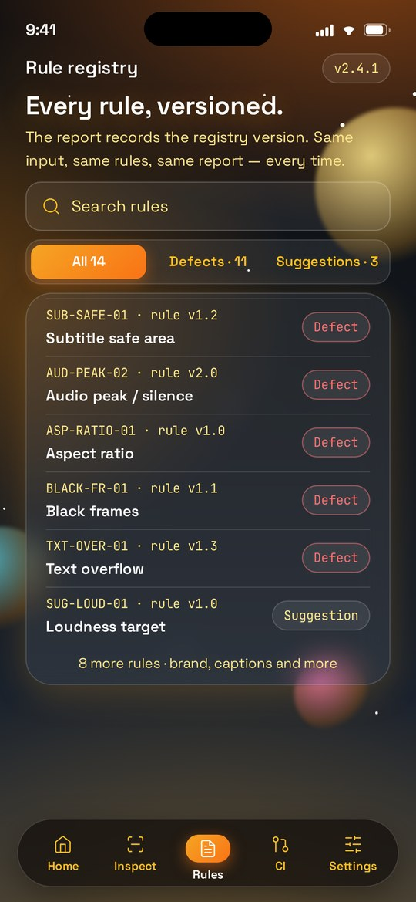

  

# FRAME POLICE

**A linter for video.** Pick a finished export, and fourteen versioned rules inspect it in seconds — then one number answers the only question that matters: *is this safe to publish?*

**[Try the live demo →](https://mr-vishwet.github.io/frame-police/)**

---

Machine-checkable defects ship anyway, because nobody runs the checks. A subtitle sits below the safe area and gets cropped. An audio peak clips. A few black frames slip into a cut. FRAME POLICE is the linter video never had: it inspects an export against a pinned rule registry and ends in a verdict a pipeline can read — exit 0 means ship it, exit 1 means defects found.

- **Inspect** — 14 rules (11 defect checks, 3 suggestions) run on the device in about 19 seconds. Nothing uploads.
- **The verdict** — every finding carries its evidence: the timecode, the measured value, the limit it broke. The score is a guide; the exit code is the verdict.
- **Defects decide, suggestions advise** — a suggestion never touches the exit code, the score, or anything a pipeline reads.
- **Fix & waive** — one-tap auto-fix with a before/after preview, confirmed by re-inspection; or waive a defect with a reason that stays on the report.
- **Rule registry** — every rule versioned (v2.4.1); each report records the registry that ran it, so the same export under the same rules always gives the same report.

The demo reel is built to fail: **known-bad.mp4** comes back with **5 defects and a score of 55**.

  
  
  
  
  

